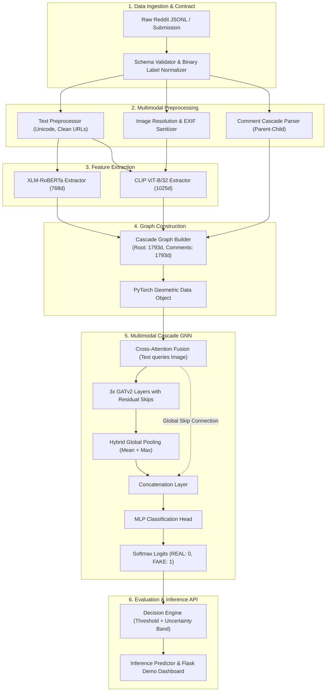

# System Architecture: Multimodal Cascade GNN

> **End-to-End Binary Fake News Detection Pipeline on Reddit**

---

## 1. Architectural Overview

The system detects fake news by analyzing Reddit submissions through three synergistic modalities:
1. **Semantic Text:** Contextual linguistic representation via XLM-RoBERTa (768d).
2. **Visual Content & Cross-Modal Consistency:** Joint vision-language representation via CLIP ViT-B/32 (1025d: 512 text + 512 image + 1 similarity).
3. **Propagation Dynamics:** Information cascade graphs constructed from Reddit discussion comment trees with GATv2 message passing.

---

## 2. Key Components

### 2.1. Feature Dimensionality
- **Text Embedding:** 768 dimensions (Mean-pooled XLM-RoBERTa representation of submission title and clean text).
- **Vision-Language Embedding:** 1025 dimensions:
  - 512d: CLIP Text Projection
  - 512d: CLIP Visual Projection
  - 1d: Text-Image Cosine Similarity score
- **Node Input Dimension:** $768 + 1025 = 1793$ dimensions.
- **Cascade Nodes:** Root node carries submission multimodal features (1793d). Comment nodes carry comment text embeddings (768d) and zero-padded image features (1025d).

### 2.2. Model Mechanics
- **Fusion Module:** Multi-Head Cross-Attention where text acts as query ($Q$) against visual keys and values ($K, V$), followed by gated residual mixing:
  $$\mathbf{h}_{\text{fused}} = \text{LayerNorm}(g \cdot \text{Attn}(Q, K, V) + (1 - g) \cdot Q)$$
- **Graph Neural Network:** 3-layer GATv2 (Graph Attention Network v2) with 8 attention heads per layer, LayerNorm, and residual shortcut connections.
- **Pooling & Readout:** Combines global mean pooling, global max pooling, and a pre-GNN skip connection to preserve root semantic signal.

---

## 3. Serving & Predictor Engine
The inference engine (`src/fakenews/serving/predictor.py`) implements:
- Direct checkpoint binding from YAML configuration.
- Strict rejection of unverified fallbacks.
- Uncertainty estimation: classifications within a margin $\pm 0.15$ of the decision threshold are flagged as `UNCERTAIN`.
- Diagnostic warnings for missing images or absent comment cascades.
